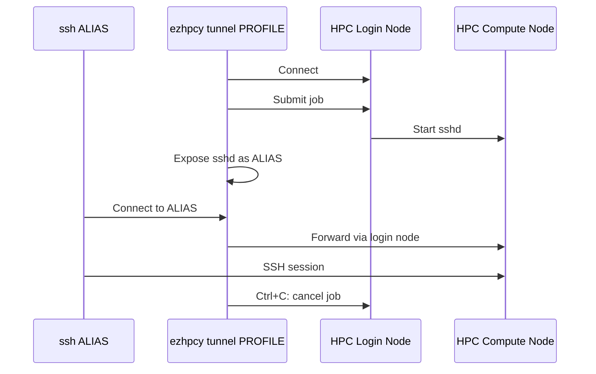

# EzHPCy

EzHPCy is a small(ish) tool that makes it easy to establish an SSH connection directly
to a compute node on an HPC system such as the one(s) found at
Technical University of Denmark ([DTU]).

This allows the user to connect to the compute node using the remote server capabilities
of their favourite editor.

Key benefits:

- If you use **notebooks**, **debuggers**, and other such editor features, they now run on the compute node instead of login node.
- Any **terminals** you open in the connected editor are on the compute node.
- Any LLM extensions now run on the compute not, not login node. This reduces congestion on the login nodes significantly.
- Works with many editors and other tools (any compliant OpenSSH clients)

It works for networks that have the following properties:

- Compute nodes may or may not have OpenSSH server running
- User can expose (large, non-root) port on compute nodes
- Login node can be reached via SSH
- Login node can reach compute nodes over network
- Login node and compute node share a filesystem

Both batch jobs and interactive jobs are supported, though you should probably only
use interactive nodes to avoid invoking the ire of the HPC administrators and
wasting scarce resources on the shared facility.

Supported schedulers are:

- [IBM Spectrum LSF]: Batch and interactive
- [PBS Pro/OpenPBS]: Only interactive tested

**Please use EzHPCy responsibly!**
If you are not familiar with HPC systems, please familiarise yourself with their
operation and the guidelines of your local HPC system to avoid accidentally
abusing the resources that have kindly and generously been made available to you.

## Coarse Overview

The operating principle of EzHPCy can be seen in the diagram below. In essence:

- Start an unprivileged, secure OpenSSH server on compute node
- Forward traffic to this through login node via SSH (`direct-tcpip`)

## Security Considerations

Significant care has been given to the security of EzHPCy.
The networking setup is relatively simple with a small attack surface.
Industry standard implementations are used (OpenSSH, Python's `cryptography` library)
and only a standard, secure protocol is used (SSH).

Importantly, all traffic still goes through the login node and is authenticated using
the authentication scheme set up by the HPC administrators.
Nothing is circumvented or bypassed (see slight caveat below).

Because EzHPCy controls both the server and can instruct the client on which
authentication scheme to use for connections, it is able to harden the server
significantly:

- Generates a per-host key-pair (`ed25519`) and instructs clients to only trust this key
- Generates a per-profile key-pair (`ed25519`) and instructs server to only trust this key

This ensures that nobody else on the network can disguise themselves as a server to the
client, and similarly ensures that no one else on the HPC network can log in as a client.

Locally EzHPCy forwards all traffic on a chosen port to the remote server,
at which point authentication is done. This means that a local process on the client
system (such as a malicious user on the same system) can send traffic to the EzHPCy
managed OpenSSH server, though this would be immediately dropped as the malicious
user on the local client system would have no means with which to authenticate itself.

**Slight caveat:** EzHPCy allows you to securely store your password in the
keyring of your local operating system, if you so choose.
This does not weaken the security of the authentication scheme, but means
that if you leave your local PC unlocked and unattended,
someone could use this to access the HPC.
This is no different to the case where you had a regular connection to the HPC
open and left your PC unattended.
As such, this should not be a security concern to any reasonable security practitioner.
_This is disabled by default and somewhat a somewhat hidden feature to ensure
that users have some basic grasp of the terminal._

## Implementation

EzHPCy is unapologetically modern and requires Python 3.15 to run.

## License

EzHPCy is released under the [MIT License](LICENSE).

## History

Previous, unreleased versions of EzHPCy used a proxy interface with an IPC protocol (see [Janelia] acknowledgement below).

A significant refactoring was done to switch to [`asyncssh`](https://github.com/ronf/asyncssh) from [`paramiko`](https://www.paramiko.org/) motivated by security, maintainance, and the desire to switch to an `async` implementation.

With this in mind, the CLI interface was first refactored to use the excellent [`cyclopts`](https://cyclopts.readthedocs.io/en/stable/) library by [Brian Pugh](https://github.com/BrianPugh) instead of [`typer`](https://typer.tiangolo.com/) in order to reduce the number of hacks required to achieve the interface I wanted and simultaneously getting native `async` functionality.

## Acknowledgements

I had wondered for a while whether an easier instrumentation of the [DTU] HPC system
might be possible, in a way that would enable me to connect directly to a compute node
using my editor or other SSH-capable tools.

I stumbled upon [Janelia]'s configuration [found here](https://github.com/JaneliaSciComp/ssh_cluster_tunnel_for_vscode)
for their HPC system, which used OpenSSH's
`ProxyCommand` feature to tunnel through their HPC setup.
The first decent versions of EzHPCy (v0.1, v0.2) also used `ProxyCommand` and
a local TCP server in combination with a simple IPC protocol,
which worked quite well, but was overly complex and had a larger attack surface.

## LLM Disclosure

**This README has been written entirely by a human; please read it!**

The very first versions of EzHPCy were made without the use of agentic programming.

Later refactoring and expansion of EzHPCy has made extensive use of LLMs, though
under somewhat careful review.
_I have found that even with the latest models,
they have to be kept on a relatively short leash,
lest they take over the project entirely and end up producing something
overly complex and entirely opaque._

[DTU]: https://www.dtu.dk/english
[Janelia]: https://www.hhmi.org/research/janelia
[PBS Pro/OpenPBS]: https://www.openpbs.org/
[IBM Spectrum LSF]: https://www.ibm.com/docs/en/spectrum-lsf
